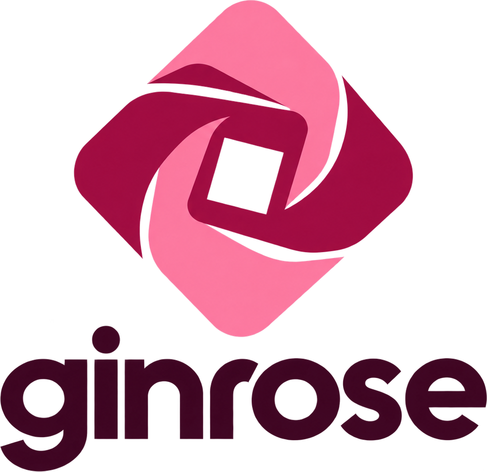

<p align="center">
  <picture>
    <source media="(prefers-color-scheme: dark)" srcset="assets/ginrose-wordmark-light.png">
    
  </picture>
</p>

<p align="center">A Roblox launcher for Linux, built around <a href="https://github.com/microlift/rosemary">Rosemary</a>.</p>

> [!WARNING]
> ## This is a personal project
>
> Ginrose was made for one computer (Fedora, Hyprland, an NVIDIA card) and is
> only tested there. It may well not work on yours: other distros, desktops and
> GPUs have not been tried, and the installer has not been through many hands
> yet. It is shared as it is, with no promise of support or fixes. If it breaks
> for you, an issue is welcome, but it may not get an answer soon, or at all.
>
> Rosemary itself is experimental, and so is running Roblox on it.
> IF YOU USE THIS TO EXPLOIT I AM PERSONALLY GOING TO SEND 10 MISSILES TO YOUR HOME!!! TWAT!

Ginrose runs the official macOS Roblox client on Linux through Rosemary, a
macOS compatibility layer. It downloads the client straight from Roblox, keeps
it up to date, sets it up to run well, and shows what you are playing on
Discord. The client itself is never modified: no patches, no injected code.
The only file Ginrose writes inside it is `ClientAppSettings.json`, the one
Roblox reads local settings from.

## Features

- **Updates** the macOS client from Roblox's own CDN before each launch.
- **Uncapped frame rate.** The Mac client locks to the monitor's refresh rate
  and its menu stops at 240; Ginrose lifts both.
- **FastFlags from Roblox's allowlist only**, with a one-click preset that
  turns off anti-aliasing and grass. Flags off the allowlist do nothing in the
  current client, so Ginrose does not offer them.
- **Per-game profiles**: graphics level, frame cap and flags applied when a
  link names that game.
- **Your own Discord Rich Presence**: game name, creator, icon, time played
  and a button to the game page. Games that send status through the
  BloxstrapRPC convention can set their own text and images.
- **Machine checks** before launching: a GPU handed to a virtual machine, a
  missing NVIDIA Vulkan driver, and a video wallpaper (mpvpaper) that keeps
  decoding behind the game.
- **Copy and paste with Ctrl.** The Mac client expects Command, which most
  Linux desktops keep for themselves (needs Ginrose's Rosemary build, below).
- Opens the **Play buttons on roblox.com**, and gives the Roblox window its
  icon in taskbars and docks.

## Install

Ginrose is on Flathub:

```sh
flatpak install flathub me.daeese.apps.ginrose
```

The Flatpak comes with Ginrose's build of
[Rosemary 0.4.1](https://github.com/microlift/rosemary/releases/tag/v0.4.1),
which has microphone input for voice chat and lets Ctrl stand in for Command in
copy and paste, plus fixes that are not in a release yet: one
[keeps the mouse cursor in sync](https://github.com/microlift/rosemary/pull/165)
after switching windows, and two let Roblox start again while an earlier copy
is closing ([#189](https://github.com/microlift/rosemary/pull/189),
[#190](https://github.com/microlift/rosemary/pull/190)). It also plays video
in experiences: H.264 is decoded on the GPU (Vulkan, VA-API or CUDA) and the
AAC sound on the CPU, both through FFmpeg 8, which the Flatpak gets from the
runtime's codecs extension. Without a usable FFmpeg, video stays blank instead
of crashing. The setup downloads Roblox on the first run.

To have it open the Play buttons on roblox.com when another app already does,
run once:

```sh
xdg-mime default me.daeese.apps.ginrose.player.desktop x-scheme-handler/roblox-player x-scheme-handler/roblox
```

### Building the Flatpak

```sh
tools/flatpak.sh path/to/rosemary --install
```

### Native build

For the author's machine only, with Rust installed:

```sh
./install.sh --source
```

## Discord

Rich Presence works out of the box while the Discord app is open: it shows the
game you're in, its icon, how long you've been playing and a link to it.

## Commands

```
ginrose                 the launcher (the setup on the first run)
ginrose setup           run the setup again
ginrose launch [link]   start Roblox, joining the game a link names
ginrose update          download the current Roblox
ginrose rosemary PATH   use a Rosemary binary you built
ginrose status          what is installed and what would get in the way
```

## Credits

- [Rosemary](https://github.com/microlift/rosemary) does the hard part:
  running macOS programs on Linux.
- [Nutmeg](https://github.com/frolleks/nutmeg) showed how a Rosemary
  bootstrapper fits together.
- The BloxstrapRPC message format comes from
  [Bloxstrap](https://github.com/bloxstraplabs/bloxstrap).

## License

Ginrose is free software under the GNU General Public License, version 3 or
later; see [COPYRIGHT](COPYRIGHT) and [LICENSE](LICENSE). Rosemary is GPL-3.0
as well.

The name "Ginrose", its logo and its application ID are not covered by that
license: a modified version has to go by its own name. See
[TRADEMARKS.md](TRADEMARKS.md).

### Official builds

Official builds come only from
[ginrose-flatpak](https://github.com/nunreasonable/ginrose-flatpak) (and
Flathub, once it is there). They refuse to start a modified Roblox client. A
build from somewhere else, or a fork that drops that check, is not Ginrose,
whatever it calls itself.

Each release can be checked against this source: see
[Verifying a release](#verifying-a-release).

Ginrose is not affiliated with or endorsed by Roblox Corporation.

### Verifying a release

Releases are built reproducibly: the toolchain is pinned in
`rust-toolchain.toml`, and builds drop machine-specific paths. To check that a
release's binary really comes from this source, rebuild its tag and compare:

```sh
tools/verify-release.sh 0.2.6
```

It downloads the release, checks it against `SHA256SUMS`, builds tag `v0.2.6`,
and compares the two `ginrose` binaries.
